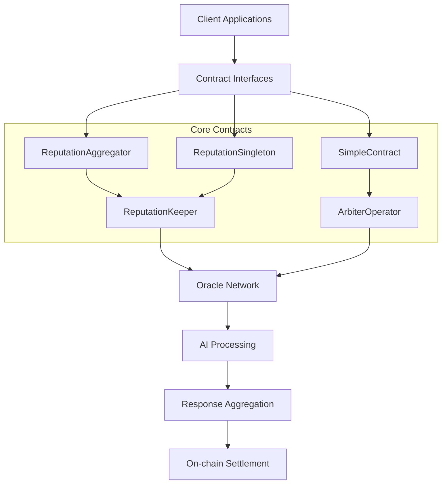

# Verdikta Dispatcher Smart Contracts

The Verdikta Dispatcher is a comprehensive smart contract system that provides decentralized AI-powered dispute resolution services. It consists of multiple specialized contracts that work together to manage oracle networks, handle requests, aggregate responses, and maintain reputation systems.

!!! note "Checked against the code"
    Revised on 2026-11-22 against the contracts in this repository and the aggregator deployed on Base mainnet. The ReputationAggregator is the production contract and is paid in ETH: a requester needs no LINK and approves no token. ReputationSingleton and SimpleContract are legacy contracts that are still paid in LINK.

## Architecture Overview



## Contract Components

### Core Aggregation Contracts

| Contract | Purpose | Use Case | Paid In |
|----------|---------|----------|---------|
| **[ReputationAggregator](contracts/reputation-aggregator.md)** | Multi-oracle commit-reveal aggregation | High-stakes disputes requiring maximum security | ETH, sent with the request |
| **[ReputationSingleton](contracts/reputation-singleton.md)** | Single-oracle fast resolution | Simple disputes needing quick resolution | LINK (legacy) |
| **[SimpleContract](contracts/simple-contract.md)** | Basic oracle interaction | Development and testing | LINK (legacy) |

### Infrastructure Contracts

| Contract | Purpose | Use Case |
|----------|---------|----------|
| **[ReputationKeeper](contracts/reputation-keeper.md)** | Oracle reputation and selection | Managing oracle quality and availability |
| **[ArbiterOperator](contracts/arbiter-operator.md)** | Chainlink operator with restrictions | Ensuring only approved contracts can request oracles |

## Network Deployments

The LINK addresses below are used for the Chainlink request path and by the legacy contracts. A requester of the ReputationAggregator does not need LINK. The full list is in the [Deployment Guide](deployment/index.md).

### Base (Mainnet)
- **ReputationAggregator (ETH-funded)**: `0xd8F38bCBEE43bE3bd31655a563f20c9B3e67142a`
- **ReputationKeeper** (the aggregator's `reputationKeeper()`): `0x2D96cc4F6619d08FC14b7ee0eec02d1F3eE1d0b0`
- **Wrapped Verdikta Token** (the keeper's `verdiktaToken()`): `0x1EA68D018a11236E07D5647175DAA8ca1C3D0280`
- **LINK Token**: `0x88Fb150BDc53A65fe94Dea0c9BA0a6dAf8C6e196`

### Base Sepolia (Testnet)
- **ReputationAggregator (ETH-funded)**: `0xe8a385E473EA710c5a88Cc72681a16a26fe380e4`
- **ReputationKeeper** (the aggregator's `reputationKeeper()`): `0xE09821277D9af702F7910a57e85EaC6D83e4d794`
- **Wrapped Verdikta Token** (the keeper's `verdiktaToken()`): `0x94e3c031fe9403c80E14DaFbCb73f191C683c2B1`
- **LINK Token**: `0xE4aB69C077896252FAFBD49EFD26B5D171A32410`
- **Verdikta Token**: `0xe46F6b494F111d958CDBB52536AD78c4eEeB0149`

### Ethereum Sepolia (Testnet)
- **LINK Token**: `0x779877A7B0D9E8603169DdbD7836e478b4624789`
- **Verdikta Token**: `0xbb7079F45367ce928789cc40d8C9D4E3A19b0a49`

## Quick Start

### For Developers
1. **Choose Your Contract**: Start with [ReputationAggregator](contracts/reputation-aggregator.md), the production contract, which is paid in ETH. [ReputationSingleton](contracts/reputation-singleton.md) and [SimpleContract](contracts/simple-contract.md) are legacy contracts paid in LINK
2. **Review Integration**: See [Integration Examples](examples/index.md) for code samples
3. **Deploy & Test**: Follow our [Deployment Guide](deployment/index.md)

### For Oracle Operators
1. **Deploy Operator**: Set up an [ArbiterOperator](contracts/arbiter-operator.md) contract
2. **Register Oracle**: Register with the [ReputationKeeper](contracts/reputation-keeper.md)
3. **Monitor Performance**: Track reputation scores and earnings

## Getting Started

### Integration Examples

```solidity
// Simple integration with the ReputationAggregator. The request is paid in ETH
// sent with the call: there is no token to approve.
interface IReputationAggregator {
    function requestAIEvaluationWithApproval(
        string[] calldata cids,
        string calldata addendumText,
        uint256 alpha,
        uint256 maxOracleFee,
        uint256 estimatedBaseCost,
        uint256 maxFeeBasedScalingFactor,
        uint64 requestedClass
    ) external payable returns (bytes32);
    function maxTotalFee(uint256 requestedMaxOracleFee) external view returns (uint256);
}

contract MyDApp {
    IReputationAggregator public verdiktaDispatcher;

    uint256 public constant MAX_ORACLE_FEE = 15e13; // 0.00015 ETH per oracle at most

    constructor(address aggregator) {
        verdiktaDispatcher = IReputationAggregator(aggregator);
    }

    // Worst-case ETH to send with requestDispute()
    function quote() external view returns (uint256) {
        return verdiktaDispatcher.maxTotalFee(MAX_ORACLE_FEE);
    }

    function requestDispute(string[] calldata evidence) external payable returns (bytes32 requestId) {
        requestId = verdiktaDispatcher.requestAIEvaluationWithApproval{value: msg.value}(
            evidence,
            "Additional context",
            500,            // alpha (reputation weight)
            MAX_ORACLE_FEE, // max oracle fee, in ETH wei
            8e9,            // estimated base cost, in ETH wei
            5,              // max fee scaling factor
            128             // requested class
        );

        // Store requestId and wait for fulfillment.
        // The unspent part of the prepayment is credited to this contract in the
        // aggregator: see the ReputationAggregator page for how to collect it.
    }
}
```

### Frontend Integration

```javascript
// Connect to deployed contract
const contract = new ethers.Contract(
    contractAddress,
    REPUTATION_AGGREGATOR_ABI,
    signer
);

// Size the prepayment: the worst case for your fee ceiling,
// less any credit you already hold in the aggregator
const maxOracleFee = ethers.parseEther("0.00015");
const required = await contract.maxTotalFee(maxOracleFee);
const credit = await contract.ethOwed(await signer.getAddress());
const value = required > credit ? required - credit : 0n;

const args = [
    ["QmHash1", "QmHash2"], // IPFS content hashes
    "Additional evidence",   // Optional addendum
    500,          // alpha (reputation weight 0-1000)
    maxOracleFee, // max oracle fee, in ETH wei
    8_000_000_000n, // estimated base cost, in ETH wei
    5,            // max fee scaling factor
    128           // requested class (oracle type)
];

// Oracle selection is random, so add headroom to the gas estimate
const estimate = await contract.requestAIEvaluationWithApproval.estimateGas(...args, { value });

// Submit evaluation request: the ETH travels with the call
const tx = await contract.requestAIEvaluationWithApproval(...args, {
    value,
    gasLimit: (estimate * 150n) / 100n
});

// Monitor for results
contract.on("FulfillAIEvaluation", (aggRequestId, likelihoods, justifications) => {
    console.log("Evaluation complete:", {
        aggRequestId,
        likelihoods: likelihoods.map(l => l.toString()),
        justifications
    });
});
```

A round that has not finished within the timeout (`responseTimeoutSeconds()`, 300 seconds on Base mainnet) is not closed automatically: call `finalizeEvaluationTimeout(aggRequestId)` to close it and have the unspent part of your prepayment credited back. See [ReputationAggregator](contracts/reputation-aggregator.md).

## API Reference

- **[Contract Interfaces](api/index.md)** - Complete ABI documentation
- **[Events Reference](api/events.md)** - All contract events and their parameters
- **[Error Codes](api/errors.md)** - Error conditions and troubleshooting

## Advanced Topics

- **[Reputation System](advanced/reputation.md)** - How oracle scoring works
- **[Fee Mechanisms](advanced/fees.md)** - ETH fees, prepayment and refunds for the aggregator; LINK fees for the legacy contracts
- **[Security Model](advanced/security.md)** - Commit-reveal and other protections
- **[Oracle Selection](advanced/oracle-selection.md)** - Weighted selection algorithms
- **[ETH Payment Implementation](advanced/eth-payment-migration.md)** - How and why the aggregator pays arbiters in ETH while keeping the Chainlink request path; read the implementation notes at its top first

## Support

- **[Troubleshooting](troubleshooting/index.md)** - Common issues and solutions
- **[FAQ](faq.md)** - Frequently asked questions
- **[Discord](https://discord.gg/verdikta)** - Community support
- **[GitHub Issues](https://github.com/verdikta/verdikta-dispatcher/issues)** - Report bugs 