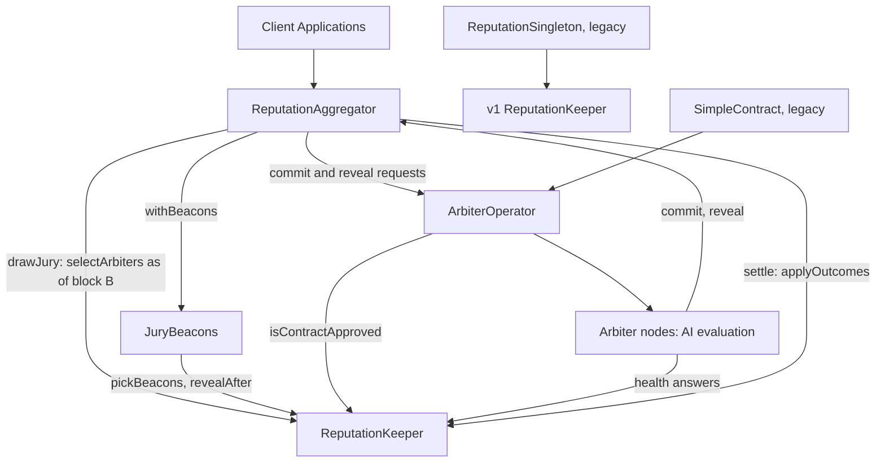

# Verdikta Dispatcher Smart Contracts

The Verdikta Dispatcher is a smart contract system that provides decentralized AI-powered evaluation and dispute resolution. Its contracts draw a jury of staked arbiters for each request, collect their answers by commit-reveal, aggregate them, pay the arbiters in ETH and keep their reputation.

!!! note "Version 2 (not deployed yet)"
    Revised on 2026-11-25 for the v2 contracts on the `beacon` branch. v2 is a breaking redeploy of the deployed v1 contracts (tag `aggregator-v0.1.0`) and is **not deployed yet**: its addresses are set at the v2 deployment. In v2 one aggregator serves every jury size, because each request carries its jury (K drawn, M promoted, N counted, P clustered, and a timeout); the jury is drawn after the request from a later block hash, optionally mixed with arbiter beacons; and the round needs a few permissionless calls after the request. The ReputationAggregator is paid in ETH: a requester needs no LINK and approves no token. ReputationSingleton and SimpleContract are legacy contracts that are still paid in LINK and were written for the v1 keeper. [MIGRATION.md](https://github.com/verdikta/verdikta-dispatcher/blob/beacon/reputationBasedAggregator/MIGRATION.md) lists what changes for every consumer.

## Architecture Overview



## Contract Components

### Core Contracts (v2)

| Contract | Purpose | Paid In |
|----------|---------|---------|
| **[ReputationAggregator](contracts/reputation-aggregator.md)** | Escrows a request, draws its jury (`drawJury`), runs commit-reveal with random promotion, clusters the answers, settles every juror's outcome with the keeper | ETH, sent with the request |
| **[ReputationKeeper](contracts/reputation-keeper.md)** | Arbiter registry and stake, two-score reputation, blocks and bans, hash-chain health calls and the freeze, selection from a shortlist as of the request block | VDKA stake |
| **[JuryBeacons](contracts/jury-beacons.md)** | Optional per request: picks 4 beacon arbiters and mixes the first 2 hash-chain values into the jury's seed | (beacons are paid by the aggregator) |
| **[ArbiterOperator](contracts/arbiter-operator.md)** | Each arbiter's Chainlink operator; accepts requests only from contracts a listed keeper approves | |

### Legacy Contracts (LINK, v1 keeper)

| Contract | Purpose | Paid In |
|----------|---------|---------|
| **[ReputationSingleton](contracts/reputation-singleton.md)** | Single-oracle fast resolution | LINK |
| **[SimpleContract](contracts/simple-contract.md)** | Basic oracle interaction, development and testing | LINK |

## Network Deployments

The v2 contracts are not deployed: their addresses are set at the v2 deployment. The addresses below are the deployed **v1** contracts, which take the v1 request (7 arguments) and do not work with the v2 examples. The full list is in the [Deployment Guide](deployment/index.md).

### Base (Mainnet), v1
- **ReputationAggregator (ETH-funded)**: `0xd8F38bCBEE43bE3bd31655a563f20c9B3e67142a`
- **ReputationKeeper**: `0x2D96cc4F6619d08FC14b7ee0eec02d1F3eE1d0b0`
- **Wrapped Verdikta Token**: `0x1EA68D018a11236E07D5647175DAA8ca1C3D0280`
- **LINK Token**: `0x88Fb150BDc53A65fe94Dea0c9BA0a6dAf8C6e196`

### Base Sepolia (Testnet), v1
- **ReputationAggregator (ETH-funded)**: `0xe8a385E473EA710c5a88Cc72681a16a26fe380e4`
- **ReputationKeeper**: `0xE09821277D9af702F7910a57e85EaC6D83e4d794`
- **Wrapped Verdikta Token**: `0x94e3c031fe9403c80E14DaFbCb73f191C683c2B1`
- **LINK Token**: `0xE4aB69C077896252FAFBD49EFD26B5D171A32410`
- **Verdikta Token**: `0xe46F6b494F111d958CDBB52536AD78c4eEeB0149`

### Ethereum Sepolia (Testnet)
- **LINK Token**: `0x779877A7B0D9E8603169DdbD7836e478b4624789`
- **Verdikta Token**: `0xbb7079F45367ce928789cc40d8C9D4E3A19b0a49`

## Quick Start

### For Developers
1. **Read the round lifecycle**: request, `drawJury`, commits, `closeCommits` if needed, `promote`, reveals, result, `settle`. See [Integration Examples](examples/index.md#the-round-lifecycle)
2. **Choose a jury and quote it**: `maxTotalFee(maxFee, minFee, withBeacons, K, P)`; see [Fee Mechanisms](advanced/fees.md)
3. **Integrate**: [Integration Examples](examples/index.md), [Smart Contract Walkthrough](examples/integration.md), [Frontend Guide](examples/frontend.md)
4. **Deploy and test**: [Deployment Guide](deployment/index.md)

### For Arbiter Operators
1. **Add the v2 keeper to your operator**: `addReputationKeeper(<v2 keeper>)` on your [ArbiterOperator](contracts/arbiter-operator.md)
2. **Register**: `registerArbiter(operator, jobId, fee, classes, chainHead)` with the [ReputationKeeper](contracts/reputation-keeper.md), staking 100 VDKA
3. **Switch the node to the v2 commit format and run its health job**: see [MIGRATION.md](https://github.com/verdikta/verdikta-dispatcher/blob/beacon/reputationBasedAggregator/MIGRATION.md#arbiter-node-new-work)
4. **Monitor**: scores, blocks and freezes with `getArbiter(key)`; earnings with `ethOwed(owner)`

## Getting Started

### Integration Example

```solidity
// A request with its jury. The request only escrows; the round is then drawn,
// promoted and settled by permissionless calls (see the round lifecycle).
interface IReputationAggregator {
    struct Jury { uint8 K; uint8 M; uint8 N; uint8 P; uint40 timeout; }
    function requestAIEvaluationWithApproval(
        string[] calldata cids,
        string calldata addendumText,
        uint256 alpha,
        uint256 maxFee,
        uint256 minFee,
        uint256 estimatedBaseCost,
        uint256 maxFeeBasedScalingFactor,
        uint64 requestedClass,
        bool withBeacons,
        Jury calldata jury
    ) external payable returns (bytes32);
    function maxTotalFee(uint256 maxFee, uint256 minFee, bool withBeacons, uint8 K, uint8 P)
        external view returns (uint256);
    function drawJury(bytes32 aggId) external;
}

contract MyDApp {
    IReputationAggregator public verdiktaDispatcher;

    uint256 public constant MAX_FEE = 15e13; // 0.00015 ETH per arbiter at most

    constructor(address aggregator) {
        verdiktaDispatcher = IReputationAggregator(aggregator);
    }

    // Worst-case ETH to send with requestDispute(): Small jury, no floor, no beacons
    function quote() external view returns (uint256) {
        return verdiktaDispatcher.maxTotalFee(MAX_FEE, 0, false, 6, 3);
    }

    function requestDispute(string[] calldata evidence) external payable returns (bytes32 requestId) {
        requestId = verdiktaDispatcher.requestAIEvaluationWithApproval{value: msg.value}(
            evidence,
            "Additional context",
            500,            // alpha (reputation weight)
            MAX_FEE,        // fee ceiling per arbiter, in ETH wei
            0,              // fee floor per juror (none)
            8e9,            // estimated base cost, in ETH wei
            5,              // max fee scaling factor
            128,            // arbiter class
            false,          // no beacons
            IReputationAggregator.Jury({K: 6, M: 5, N: 4, P: 3, timeout: 300})
        );
        // The unspent prepayment is credited to this contract in the aggregator.
    }

    // From two blocks after the request; within 30 s it earns this contract the draw reward
    function draw(bytes32 requestId) external {
        verdiktaDispatcher.drawJury(requestId);
    }
}
```

### Frontend Integration

```javascript
// Connect to the deployed v2 aggregator
const contract = new ethers.Contract(contractAddress, REPUTATION_AGGREGATOR_ABI, signer);

// Size the prepayment for the jury: the worst case, less any credit you hold
const jury = { K: 6, M: 5, N: 4, P: 3, timeout: 300 };
const maxFee = ethers.parseEther("0.00015");
const required = await contract.maxTotalFee(maxFee, 0n, false, jury.K, jury.P);
const credit = await contract.ethOwed(await signer.getAddress());
const value = required > credit ? required - credit : 0n;

const args = [
    ["QmHash1", "QmHash2"], // IPFS content hashes
    "Additional evidence",   // optional addendum
    500,                     // alpha (reputation weight 0-1000)
    maxFee,                  // fee ceiling per arbiter, in ETH wei
    0n,                      // fee floor per juror
    8_000_000_000n,          // estimated base cost, in ETH wei
    5,                       // max fee scaling factor
    128,                     // arbiter class
    false,                   // beacons
    jury
];
const tx = await contract.requestAIEvaluationWithApproval(...args, { value });
const receipt = await tx.wait();

// Then, from two blocks later: contract.drawJury(aggId), and when due
// closeCommits(aggId), promote(aggId); settle(aggId) after the deadline if the round died.
contract.on("FulfillAIEvaluation", (aggRequestId, likelihoods, justifications) => {
    console.log("Evaluation complete:", { aggRequestId, likelihoods: likelihoods.map(String), justifications });
});
```

The round needs the calls after the request. A round still open at its deadline is dead: `settle(aggId)` closes it and credits the refund. See the [round lifecycle](examples/index.md#the-round-lifecycle) and the `readStatus`/`advance` helpers in [Integration Examples](examples/index.md#frontend-integration-examples).

## API Reference

- **[Contract Interfaces](api/index.md)** - Complete ABI documentation
- **[Events Reference](api/events.md)** - All contract events and their parameters
- **[Error Codes](api/errors.md)** - Error conditions and troubleshooting

## Advanced Topics

- **[Reputation System](advanced/reputation.md)** - Two scores, the points per round, blocks, bans and the freeze
- **[Fee Mechanisms](advanced/fees.md)** - The quote, fee ceiling and floor, rewards, refunds, committer shares and the arbiter pool; LINK fees for the legacy contracts
- **[Security Model](advanced/security.md)** - The v2 threat model: the draw, beacons, commit-reveal binding, collusion and jury size
- **[Oracle Selection](advanced/oracle-selection.md)** - The two-phase draw, beacons, the shortlist, and K drawn → M promoted → N counted → P clustered
- **[ETH Payment Implementation (history)](advanced/eth-payment-migration.md)** - The v1 design note on paying arbiters in ETH while keeping the Chainlink request path

## Support

- **[Troubleshooting](troubleshooting/index.md)** - Common issues and solutions
- **[FAQ](faq.md)** - Frequently asked questions
- **[Discord](https://discord.gg/verdikta)** - Community support
- **[GitHub Issues](https://github.com/verdikta/verdikta-dispatcher/issues)** - Report bugs 